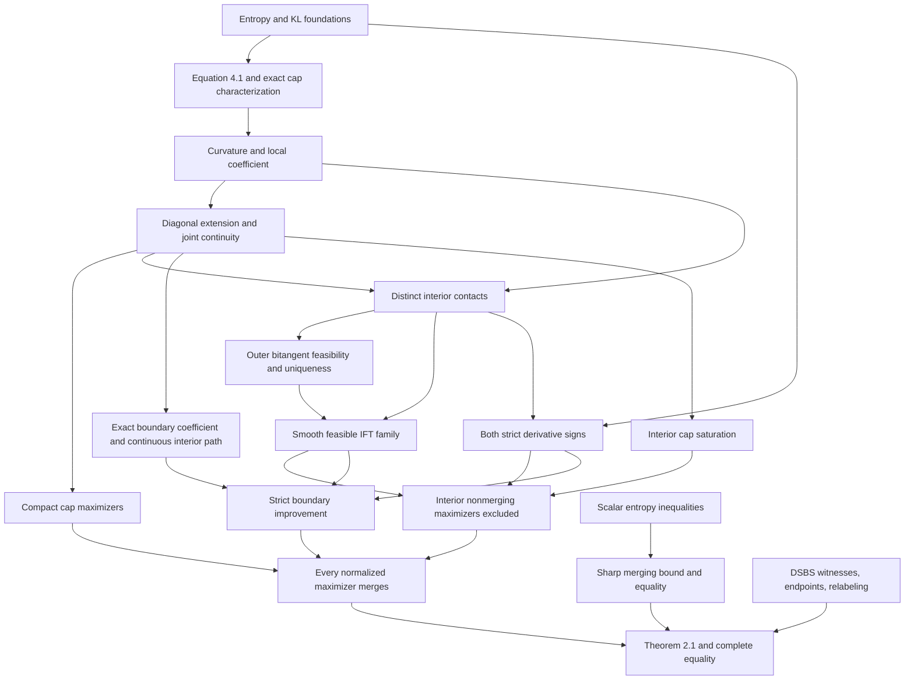

# Proof blueprint

Source: Qianmian Guo, *A Sharp Mutual Information Bound for Binary Pairs*,
arXiv:2611.02392v1 (2 November 2026). Equation numbers refer to that version.

## Completed target

`MainProof.lean` proves the unchanged scalar specification:

```lean
mainTheorem : MainTheorem
```

Here `MainTheorem = SharpBound ∧ EqualityClassification`, quantifying over
all valid `(s,c,d) ∈ [0,1]^3`. The final proof has no contact, optimization,
boundary, or implicit-family premise. The former `MaximizersMerge` obligation
is now inhabited by `maximizersMerge`.

The two exposed conclusions are `sharp_bound` and `sharp_equality_iff`.
`fixed_cap_optimum` also proves the exact constrained optimum in (3.1).

## Definitions

- `k(c,d) = 1-c-d`, `q(c,d,x) = c+k(c,d)x`.
- `H` is binary entropy in nats, with `H(0)=H(1)=0`.
- `D(x,y) = -H(x)-x log(y)-(1-x)log(1-y)`.
  This is Bernoulli KL on `x ∈ [0,1]`, `y ∈ (0,1)`.
- `J(s,c,d) = H(q(s))-(1-s)H(c)-sH(d)`.
- `S` is the supremum of `D(q(x),q(s))/D(x,s)` for `x ≠ s`, with the
  paper's zero convention for deterministic input or output.
- `phi(t) = log(2)-H((1-sqrt(t))/2)`.
- `Independent` means `s=0 ∨ s=1 ∨ c+d=1`.
- `DSBS` means `s=1/2 ∧ c=d`, including crossover probabilities above `1/2`.

## Dependency graph



## Verified steps and representative declarations

| Step | Checked declarations |
|---|---|
| KL positivity and data processing | `D_pos`, `D_eq_zero_iff`, `D_dataProcessing` |
| Tangent gap and exact cap equivalence | `equation_4_1_log_ratio`, `S_le_iff_supporting_tangent` |
| Curvature | `deriv2_entropyCurve`, `rhoSquared_eq_eta_iff`, `rhoSquared_two_roots` |
| Actual diagonal KL limit | `tendsto_klRatio_nhdsNE` |
| Attainment and unique merging input | `exists_extendedRatio_eq_S`, `S_eq_eta_iff`, `rhoSquared_lt_S` |
| Joint continuity | `exists_extendedRatio_eq_rhoSquared`, `continuousAt_S_comp` |
| Compact maximizer existence | `exists_nontrivial_normalized_maximizer` |
| Interior contact attainment and ordering | `exists_ordered_interior_contacts` |
| Lower support and uniqueness | `klCap_of_outer_bitangent_local`, `outer_bitangent_unique` |
| Actual contact-system invertibility | `contactSystem_partial_isInvertible` |
| Smoothness and exact cap preservation | `exists_feasible_contact_family` |
| Strict input-direction sign | `informationCoords_supporting_input_curve_deriv_pos` |
| Reflected-contact scalar sign | `contactQ_at_reflection_pos` |
| Placement of actual contacts | `contactReflection_le_of_supporting_contact` |
| Strict output-direction sign | `informationCoords_supporting_output_curve_deriv_neg` |
| Exact boundary coefficient | `S_zero_right`, `S_zero_left` |
| Unique interior continuation and limit | `existsUnique_boundary_continuation`, `tendsto_boundaryContinuationSlope` |
| Strict boundary improvement | `boundary_improvement_zero_right` (other side by relabeling) |
| Cap saturation | `interior_cap_maximizer_saturates` |
| Interior maximizers merge | `interior_cap_maximizer_distinguishedInput` |
| Boundary exclusion and full reduction | `normalized_cap_maximizer_interior`, `maximizersMerge` |
| Scalar inequalities | `convexOn_posteriorEntropyCurve`, `phi_increment_le`, `phi_increment_eq_iff` |
| Merging bound with the actual S | `merging_sharp_bound`, `merging_sharp_eq_iff_dsbs` |
| Sharp attainment | `S_symmetric`, `exists_sharp_cap_witness` |
| Original target and optimum | `mainTheorem`, `sharp_bound`, `sharp_equality_iff`, `fixed_cap_optimum` |

## Alternative arguments in the formal proof

The development follows the paper's reduction while using several equivalent
arguments that fit the available analysis library:

1. Closed cap sublevel sets follow directly from continuity of fixed-test-input
   KL inequalities. Maximizer existence therefore does not presuppose the
   joint diagonal-ratio continuity theorem.
2. The local comparison `rhoSquared ≤ S` follows from strict local concavity
   contradicting the supporting tangent. The actual quotient limit is also
   proved separately, using l'Hôpital's theorem twice.
3. A twofold Rolle argument represents the extended KL ratio by curvature at
   an intermediate input. This gives joint continuity, including simultaneous
   movement of the reference input, test input, and channel.
4. Global support of an outer common tangent follows from strict convexity
   on the outer branches and concavity between the curvature roots. This
   supplies a local open-condition criterion for IFT feasibility.
5. The `c ≤ d` derivative sign follows from Bernoulli KL asymmetry and
   logarithmic inequalities, without the integral calculation in (C.4).
6. The decrease of the hyperbolic function A* and positivity in (C.8) are
   proved by elementary derivatives. Odds-coordinate algebra identifies
   this expression with the actual reflected-contact Q.
7. For `c ≥ d`, the reflected entropy secant proves the supporting-contact
   placement inequality without the integral primitive argument in C.4.
8. On a one-zero-transition channel, strict curvature growth and compact
   ratio attainment force the maximizing test input to the endpoint. This
   yields the exact boundary coefficient without monotone l'Hôpital theory.
9. The continuous boundary continuation is locally identified with the
   smooth IFT family by uniqueness of its coefficient level. The strict
   output derivative and endpoint limit then give a strict improvement.

## Final assembly and equality

For every cap `0 < lambda < 1`, a normalized maximizer exists and is
nondegenerate. Strict boundary improvement makes its channel interior.
Interior cap saturation and exclusion of distinct contacts force its input
to the distinguished configuration. There the exact coefficient is `eta`,
and the posterior-entropy argument proves the desired `phi` bound.

A DSBS attains every cap. Equality for any source makes that source a cap
maximizer, so the merging equality conditions force it to be DSBS. Coefficient
zero is precisely independence; coefficient one is handled by the entropy
maximum characterization. Output relabeling covers negative channel slope.

## Trust and remaining extensions

All 44 source modules are built. `Audit.lean` guards 80 axiom lists, including
the final unconditional theorem and its direct corollaries. Only the standard
`propext`, `Classical.choice`, and `Quot.sound` appear. No added axioms,
`sorry`, or native decision shortcuts stand in for mathematical arguments.

The scalar main theorem is complete. An explicit arbitrary probability-space
bridge and the Section 10 tensorization/Boolean-function corollary remain
separate extensions. Contact existence is established at every nonmerging
source's actual cap; a standalone arbitrary-cap version of all of Lemma 4.1
is not required by, or claimed as part of, this certificate.
