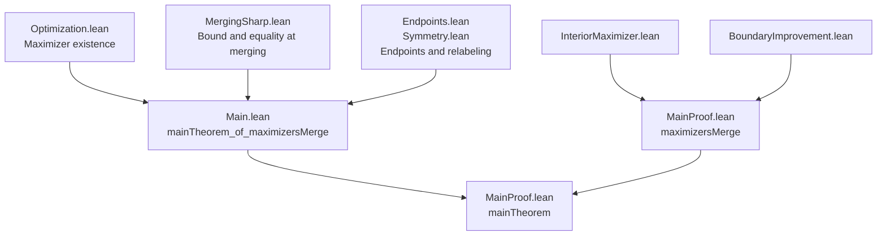
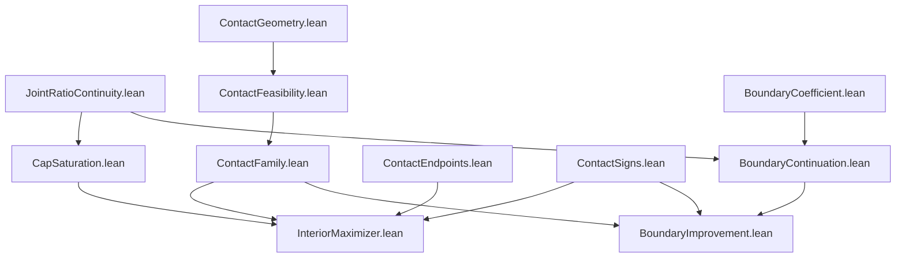
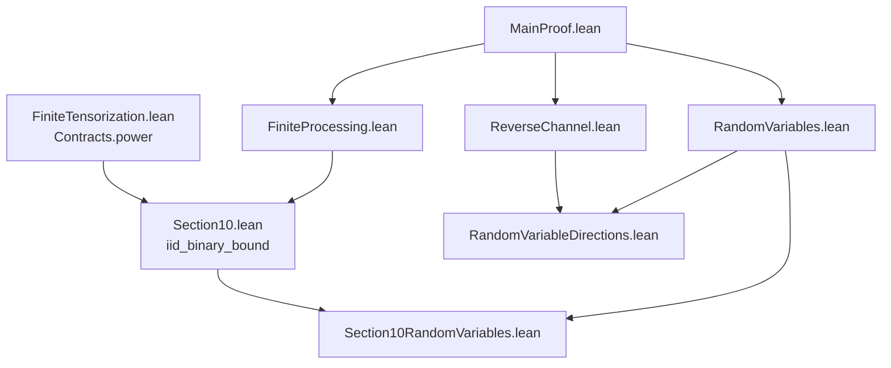

# Proof blueprint

Source: Qianmian Guo, *A Sharp Mutual Information Bound for Binary Pairs*,
arXiv:2611.02392v1 (2 November 2026). Equation numbers refer to that version.

## Completed target

All intermediate results used to prove Theorem 2.1 are proved within this
project. Applying `mainTheorem` requires no additional assumptions about
those results.

## Definitions

- `k(c,d) = 1-c-d`, `q(c,d,x) = c+k(c,d)x`.
- `H` is mathlib's binary entropy in nats, with `H(0)=H(1)=0`.
- `D(x,y) = -H(x)-x log(y)-(1-x)log(1-y)`.
  This is Bernoulli KL on `x ∈ [0,1]`, `y ∈ (0,1)`.
  At `y=0` or `y=1`, do not interpret this real-valued formula as KL:
  for example, it gives `D(1,0)=0`, whereas the usual KL is infinite.
  The positivity and data-processing lemmas in
  [Divergence.lean](BinaryPairBound/Divergence.lean) require `y ∈ (0,1)`
  for each reference parameter. `S` handles deterministic input or output separately.
- `J(s,c,d) = H(q(s))-(1-s)H(c)-sH(d)`.
- `S` is the supremum of `D(q(x),q(s))/D(x,s)` for `x ≠ s`, with the
  paper's zero convention for deterministic input or output. Its finiteness,
  bounds in `[0,1]`, supporting-tangent characterization, and required
  continuity are proved.
- `phi(t) = log(2)-H((1-sqrt(t))/2)`.
- `Independent` means `s=0 ∨ s=1 ∨ c+d=1`.
- `DSBS` means `s=1/2 ∧ c=d`, including crossover probabilities above `1/2`.

## Dependency graph

Each box names one or more files in [`BinaryPairBound/`](BinaryPairBound/).
An arrow `A → B` means that B uses definitions or proved results from A. These are selected
proof dependencies; intermediate lemmas and other dependencies are omitted.

### Assembling Theorem 2.1

The last step in [MainProof.lean](BinaryPairBound/MainProof.lean) is exactly
`mainTheorem := mainTheorem_of_maximizersMerge maximizersMerge`.
The two inputs are the assembly theorem from
[Main.lean](BinaryPairBound/Main.lean) and the proved maximizer reduction.
In the diagram, the boundary arrow passes through
`normalized_cap_maximizer_interior`; the interior arrow uses
`interior_cap_maximizer_distinguishedInput`.

### Proving the interior and boundary steps

[ContactFamily.lean](BinaryPairBound/ContactFamily.lean) supplies
`exists_feasible_contact_family`;
[ContactSigns.lean](BinaryPairBound/ContactSigns.lean) supplies the strict
input- and output-direction derivative signs. Together with
`interior_cap_maximizer_saturates`, they prove the interior result.
The boundary branch proves `boundary_improvement_zero_right`.
The boundary proof also reuses `exists_right_interior_contact` from
[InteriorMaximizer.lean](BinaryPairBound/InteriorMaximizer.lean), not its final
maximizer conclusion.

Maximizer existence follows a separate path:
[Contraction.lean](BinaryPairBound/Contraction.lean) →
[Compactness.lean](BinaryPairBound/Compactness.lean) →
[Optimization.lean](BinaryPairBound/Optimization.lean).
It does not depend on `JointRatioContinuity.lean`.

### Using Theorem 2.1 in the later results

The arrows from `MainProof.lean` to `RandomVariables.lean` and
`FiniteProcessing.lean` pass through
[BinaryLaw.lean](BinaryPairBound/BinaryLaw.lean), which applies the scalar
theorem to a binary joint law.
[Section10.lean](BinaryPairBound/Section10.lean) combines
`Contracts.power` with `processedLaw_bound_of_cap`.
[ReverseChannel.lean](BinaryPairBound/ReverseChannel.lean) proves the
bidirectional bound and its strictness; the random-variable versions are in
[RandomVariableDirections.lean](BinaryPairBound/RandomVariableDirections.lean).

The identification with the usual KL-ratio definition is a separate result:
[FiniteKL.lean](BinaryPairBound/FiniteKL.lean) →
[FiniteKLStandard.lean](BinaryPairBound/FiniteKLStandard.lean),
ending with `coefficient_eq_standardKLCoefficient`.
It is not a premise of the tensorization or data-processing proofs.

## Theorem 2.1 proof map

The modules below develop the scalar proof of `mainTheorem`. The definitions
and conventions are listed above; the random-variable interface and Section 10
results are described below.

| Paper step | Main modules |
|---|---|
| Definitions, KL identities, equation (4.1) | `Definitions`, `Entropy`, `TangentGap`, `Divergence` |
| Exact coefficient, endpoints, relabeling | `Contraction`, `Information`, `Endpoints`, `Symmetry` |
| Curvature and diagonal ratio | `Curvature`, `ChannelCap`, `LocalCoefficient`, `RatioContinuity` |
| Joint continuity and compact maximizers | `JointRatioContinuity`, `Compactness`, `Optimization` |
| Distinct contacts and global support | `ContactGeometry`, `ContactEndpoints`, `ContactFeasibility` |
| Smooth feasible contact family | `DivergenceCalculus`, `Perturbation`, `ContactJacobian`, `ContactFamily` |
| Both strict information-derivative signs | `InformationPerturbation`, `Hyperbolic`, `ContactMonotonicity`, `ContactSymmetry`, `ReflectedSign`, `ContactPlacement`, `OutputDirection`, `ContactSigns` |
| Boundary formula, continuation, strict improvement | `BoundaryCoefficient`, `BoundaryContinuation`, `BoundaryImprovement` |
| Cap saturation and maximizers merge | `CapSaturation`, `MaximizerVariations`, `InteriorMaximizer`, `MainProof` |
| Scalar entropy inequalities and merging bound | `ScalarEntropy`, `Merging`, `MergingSharp` |
| DSBS attainment and final assembly | `SymmetricSource`, `Reduction`, `Specification`, `Main`, `MainProof` |

## Verified steps and representative declarations

| Step | Checked declarations |
|---|---|
| KL positivity and data processing | `D_pos`, `D_eq_zero_iff`, `D_dataProcessing` |
| Tangent gap and exact cap equivalence | `equation_4_1_log_ratio`, `S_le_iff_supporting_tangent` |
| Curvature | `deriv2_entropyCurve`, `rhoSquared_eq_eta_iff`, `rhoSquared_two_roots` |
| Actual diagonal KL limit | `tendsto_klRatio_nhdsNE` |
| Attainment and unique merging input | `exists_extendedRatio_eq_S`, `S_eq_eta_iff`, `rhoSquared_lt_S` |
| Joint continuity | `exists_extendedRatio_eq_rhoSquared`, `continuousAt_S_comp` |
| Compact maximizer existence | `exists_nontrivial_normalized_maximizer` |
| Interior contact attainment and ordering | `exists_ordered_interior_contacts` |
| Lower support and uniqueness | `klCap_of_outer_bitangent_local`, `outer_bitangent_unique` |
| Actual contact-system invertibility | `contactSystem_partial_isInvertible` |
| Smoothness and exact cap preservation | `exists_feasible_contact_family` |
| Strict input-direction sign | `informationCoords_supporting_input_curve_deriv_pos` |
| Reflected-contact scalar sign | `contactQ_at_reflection_pos` |
| Placement of actual contacts | `contactReflection_le_of_supporting_contact` |
| Strict output-direction sign | `informationCoords_supporting_output_curve_deriv_neg` |
| Exact boundary coefficient | `S_zero_right`, `S_zero_left` |
| Unique interior continuation and limit | `existsUnique_boundary_continuation`, `tendsto_boundaryContinuationSlope` |
| Strict boundary improvement | `boundary_improvement_zero_right` (other side by relabeling) |
| Cap saturation | `interior_cap_maximizer_saturates` |
| Interior maximizers merge | `interior_cap_maximizer_distinguishedInput` |
| Boundary exclusion and full reduction | `normalized_cap_maximizer_interior`, `maximizersMerge` |
| Scalar inequalities | `convexOn_posteriorEntropyCurve`, `phi_increment_le`, `phi_increment_eq_iff` |
| Merging bound with the actual S | `merging_sharp_bound`, `merging_sharp_eq_iff_dsbs` |
| Sharp attainment | `S_symmetric`, `exists_sharp_cap_witness` |
| Original target and optimum | `mainTheorem`, `sharp_bound`, `sharp_equality_iff`, `fixed_cap_optimum` |

## Alternative arguments in the formal proof

The development follows the paper's reduction while using several equivalent
arguments that fit the available analysis library:

1. Closed cap sublevel sets follow directly from continuity of fixed-test-input
   KL inequalities. Maximizer existence therefore does not presuppose the
   joint diagonal-ratio continuity theorem.
2. The local comparison `rhoSquared ≤ S` follows from strict local concavity
   contradicting the supporting tangent. The actual quotient limit is also
   proved separately, using l'Hôpital's theorem twice.
3. A twofold Rolle argument represents the extended KL ratio by curvature at
   an intermediate input. This gives joint continuity, including simultaneous
   movement of the reference input, test input, and channel.
4. Global support of an outer common tangent follows from strict convexity
   on the outer branches and concavity between the curvature roots. This
   supplies a local open-condition criterion for IFT feasibility.
5. The `c ≤ d` derivative sign follows from Bernoulli KL asymmetry and
   logarithmic inequalities, without the integral calculation in (C.4).
6. The decrease of the hyperbolic function A* and positivity in (C.8) are
   proved by elementary derivatives. Odds-coordinate algebra identifies
   this expression with the actual reflected-contact Q.
7. For `c ≥ d`, the reflected entropy secant proves the supporting-contact
   placement inequality without the integral primitive argument in C.4.
8. On a one-zero-transition channel, strict curvature growth and compact
   ratio attainment force the maximizing test input to the endpoint. This
   yields the exact boundary coefficient without monotone l'Hôpital theory.
9. The continuous boundary continuation is locally identified with the
   smooth IFT family by uniqueness of its coefficient level. The strict
   output derivative and endpoint limit then give a strict improvement.

## Final assembly and equality

For every cap `0 < lambda < 1`, a normalized maximizer exists and is
nondegenerate. Strict boundary improvement makes its channel interior.
Interior cap saturation and exclusion of distinct contacts force its input
to the distinguished configuration. There the exact coefficient is `eta`,
and the posterior-entropy argument proves the desired `phi` bound.

A DSBS attains every cap. Equality for any source makes that source a cap
maximizer, so the merging equality conditions force it to be DSBS. Coefficient
zero is precisely independence; coefficient one is handled by the entropy
maximum characterization. Output relabeling covers negative channel slope.

## Random variables and Section 10

1. `BinaryLaw` starts with four nonnegative atom probabilities summing to one.
   Its canonical conditional probabilities recover every atom, including null
   input rows. Shannon mutual information, defined as the sum of marginal entropies minus
   joint entropy, is proved equal to `J`. Table factorization and opposite-cell
   symmetry are proved equivalent to the scalar independence and DSBS predicates.
2. `RandomVariables` constructs this law from the actual joint events of
   measurable `W Z : Ω → Bool` under any probability measure. Its independence
   predicate is proved equivalent to mathlib's `ProbabilityTheory.IndepFun`.
3. `FiniteEntropy` defines homogeneous density entropy
   `Ent_p(f) = Σ p f log f − (Σ p f) log(Σ p f)` and proves nonnegativity
   and the data-processing inequality. `FiniteEntropyConvex` proves log-sum
   and convexity in the density, allowing zero weights and zero atoms.
4. The general KL definition is `FiniteInfo.standardKLCoefficient` in
   `FiniteKLStandard`. It allows zero probabilities in `P` and directly
   restricts alternative laws by `Supported Q P` and `Q ≠ P`. The candidate
   set is assigned supremum when nonempty and zero otherwise. A deterministic
   input admits only the supported law `Q = P`, so its coefficient is zero.
   Strict Jensen equality proves that the supported KL denominator is zero
   exactly when `Q = P`, and is positive for every allowed alternative.

   `FiniteContraction` constructs the internal entropy-ratio coefficient and
   proves it lies in `[0,1]` and satisfies its own universal cap. `FiniteKL`
   identifies density ratios with supported KL ratios. `FiniteKLStandard`
   proves that the internal coefficient equals the general definition with
   the unchanged input excluded. `BinaryKernel` identifies this coefficient
   with scalar `S`, including deterministic binary inputs and outputs.

   `FiniteKLAGKN` supplies the full-support special case. Its definition
   `agknCoefficient` takes a proof that every input probability is positive
   and restricts alternatives only by `Q ≠ P`, as in AGKN Definition 4.
   Full support makes `Supported Q P` automatic for every `Q`.
   `agknCoefficient_eq_coefficient` proves agreement with the general
   coefficient; `agknCoefficient_binary` identifies it with `S` for
   non-deterministic binary inputs. The empty candidate set is assigned zero,
   and deterministic outputs are proved to give coefficient zero.
   `iid_binary_bound_agkn` states the Section 10 inequality directly with
   this full-support coefficient.
5. `FiniteJoint` reconstructs every finite joint source from its input marginal
   and conditional channel, proves exact atom recovery, and proves the
   coefficient is independent of the default output symbol used on null
   conditioning events.
6. `FiniteTensorization` proves the entropy chain identity for product laws.
   Applying the cap conditionally in one coordinate, convexity to posterior
   mixtures in the other, and the second cap gives a product cap. Induction
   gives every finite power, including the empty product. Explicit equivalences
   to `Fin n → α` and product formulas verify the IID interpretation.
   Tests depending on one coordinate give the reverse inequality, proving
   exact coefficient equality for every positive number of copies.
7. `FiniteProcessing` proves that separately applying Boolean functions to
   both observations cannot increase the coefficient. Its output atom formula
   is the actual pushforward of `p(x)K(y|x)`.
8. `Section10` combines these proved facts with the original main theorem and
   monotonicity of `phi`. It gives the bound for arbitrary finite joint sources
   and the DSBS specialization. No tensorization or processing premise remains.
   `FiniteRandomVariables` and `Section10RandomVariables` identify these finite
   pushforwards with actual event probabilities on any probability space.
   `HasIIDJointLaw` is only the joint-atom product formula for IID observations;
   the information and contraction conclusions are proved from it.
   `iid_dsbs_random_variable_bound_source` gives the paper's exact display
   with the actual source mutual information `I(U;V)` on the right.
9. `ReverseChannel` reconstructs the Bayes-reverse binary channel and proves
   mutual information symmetry. Applying the main theorem in both directions
   gives the minimum bound. Equality forces equal directed coefficients, so
   unequal coefficients give a strict bound. DSBS witnesses attain the bound
   for every equal prescribed coefficient. `RandomVariableDirections` exposes
   the minimum and strict bounds for the actual variable orders `(W,Z)` and `(Z,W)`.

## Trust and scope

All 61 source modules are built. `Audit.lean` guards 143 axiom lists for the main
theorem and the probability, finite-KL, and Section 10 results. Only the standard
`propext`, `Classical.choice`, and `Quot.sound` appear. No added axioms,
`sorry`, or native decision shortcuts stand in for mathematical arguments.

The arbitrary probability-space bridge and Section 10 Boolean-function
consequences are included. The new optimization problem for unequal prescribed
forward/reverse coefficients remains a research question in the paper; only
its asserted bound and nonattainment are formalized. Contact existence is established at every dependent, nonmerging
interior source's actual cap; a standalone arbitrary-cap version of all of Lemma 4.1
is not required by, or claimed as part of, this certificate.
