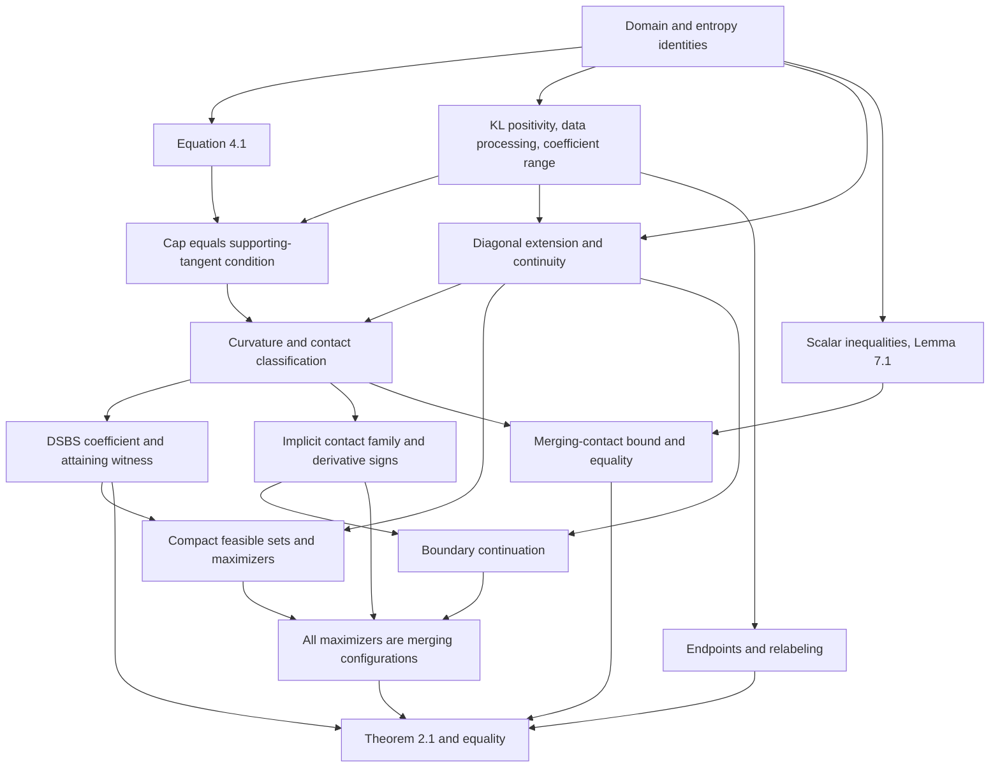

# Proof blueprint

Source: Qianmian Guo, *A Sharp Mutual Information Bound for Binary Pairs*,
arXiv:2611.02392v1 (2 November 2026). Equation and section numbers below refer
to that version. This document is a development plan, not a proof certificate.

## Scope and status

The first target is Theorem 2.1 for the scalar channel parameters `(s,c,d)`,
including its equality characterization. The later connection to arbitrary
binary random variables and the Boolean-function consequence in Section 10
are separate tasks. No unproved result in this blueprint is an axiom of the
Lean project.

| Item | Status |
|---|---|
| Scalar definitions and theorem specifications | Compiled; targets remain unproved |
| Entropy tangent identity and equation (4.1) | Proved, compiled, and axiom-audited |
| All remaining nodes below | Planned; not formally proved in this project |
| Theorem 2.1 and its equality cases | Specified target; not proved |

An unproved target is represented as a proposition, rather than a theorem
with a placeholder proof. The build must distinguish a checked specification
from an inhabitant of that specification.

The first milestone was checked on 10 November 2026 with Lean 4.35.0 and
mathlib 4.35.0. The checked declarations are `H_eq`, `D_eq_log_ratio`,
`entropy_tangent_gap`, `hasDerivAt_entropyCurve`, `deriv_entropyCurve`,
`equation_4_1`, `q_mem_Icc`, and `equation_4_1_log_ratio`, in namespace
`BinaryPairBound`. `Audit.lean` guards the axiom lists of the KL correspondence,
derivative theorem, and the two versions of equation (4.1). They use only
`propext`, `Classical.choice`, and `Quot.sound`.

## Definitions and conventions

- Parameters satisfy `s,c,d ∈ [0,1]`. Write `k = 1-c-d` and `q(x) = c+k*x`.
- `H` is `Real.binEntropy`, in nats, with `H(0)=H(1)=0`.
- For `x ∈ [0,1]` and `y ∈ (0,1)`, the finite Bernoulli divergence is
  `D(x || y) = -H(x) - x*log(y) - (1-x)*log(1-y)`.
  Prove its agreement with the paper's logarithm-of-ratio formula.
  Values of this real formula outside its domain do not model infinite KL.
- `J(s,c,d) = H(q(s)) - (1-s)*H(c) - s*H(d)`.
- If `s ∈ (0,1)` and `q(s) ∈ (0,1)`, define `S` by the supremum in (2.2),
  over `x ∈ [0,1]` with `x ≠ s`. Otherwise set `S=0`, as in the paper.
  Prove nonemptiness and boundedness before applying real supremum rules.
- `phi(t) = log(2) - H((1-sqrt(t))/2)`.
- Independence means `s=0 ∨ s=1 ∨ c+d=1`. The deterministic-input cases
  must remain independent regardless of an unused conditional parameter.
- DSBS means `s=1/2 ∧ c=d`. Allow all crossover probabilities in `[0,1]`,
  including those greater than `1/2`, and the deterministic channels.

The final statements quantify over the entire parameter cube:

1. `J(s,c,d) ≤ phi(S(s,c,d))`.
2. `J(s,c,d) = phi(S(s,c,d)) ↔ Independence(s,c,d) ∨ DSBS(s,c,d)`.

## Dependency graph

## Detailed obligations

### A. Basic scalar API (Section 2)

Prove `q(x) ∈ [0,1]` on the parameter cube, and prove the relevant strict
interior statements. Record `H(1-x)=H(x)` and
`H'(y)=log(1-y)-log(y)` for `0<y<1`. Establish the algebraic equivalence
of the two forms of Bernoulli KL, including test inputs `x=0` and `x=1`.

### B. Tangent gap (Section 4.1, equation (4.1))

For `0<s<1` and `0<q(s)<1`, prove the entropy identity
`H(x)-H(s)-H'(s)*(x-s) = -D(x || s)` for `x ∈ [0,1]`.
For every real `lambda`, let `F(x)=H(q(x))-lambda*H(x)` and
`T_s(x)=F(s)+F'(s)*(x-s)`. Use the chain rule and
`q(x)-q(s)=k*(x-s)` to prove

`F(x)-T_s(x) = lambda*D(x || s)-D(q(x) || q(s))`.

The derivative must be the actual derivative of `F`, not merely a name for
an assumed slope. The identity itself needs no positivity assumption on
`lambda` and no restriction to positively correlated channels.

### C-D. Coefficient basics and cap equivalence (Sections 2 and 4.1)

For nondegenerate marginals, prove `D(x || s)>0` when `x≠s`, binary
data processing `D(q(x) || q(s))≤D(x || s)`, and `0≤S≤1`.
For `lambda≥0`, prove equivalence of `S≤lambda` and the universal KL
inequality on `[0,1]`. Combine it with B to get the supporting-tangent
characterization. Handle `x=s` explicitly when passing between forms.

### E-H. Continuity, contact classification, and existence (Appendices A-B)

Extend the ratio on the diagonal by
`R(s,c,d;s)=k^2*s*(1-s)/(q(s)*(1-q(s)))`. Prove joint continuity where
the reference marginals are interior, uniformly with test input in `[0,1]`.
Deduce `S=max R` there and continuity of `S`. Do not assert global
continuity at deterministic marginals. Instead use `S=0` there and the
interior continuity to prove closed sublevel sets for `lambda≥0`.

For an interior normalized channel (`c>0`, `d>0`, `c+d<1`), prove the
unimodality of `rhoSquared(x)=k^2*x*(1-x)/(q(x)*(1-q(x)))` and formulas
(4.3)-(4.4) for `s0` and `eta`. Establish `S(s)=eta ↔ s=s0`.
For `0<lambda<eta`, construct unique contacts
`0<u<alpha<s0<beta<v<1`, their lower supporting common tangent, and
the classification `S(s)=lambda ↔ s=u ∨ s=v` for interior inputs.

Formal details to supply: endpoint extensions or one-sided limits for the
outer inverse branches in Appendix B; strict convexity despite one zero
of the second derivative; and compactness of the extended ratio when
deducing a strict supremum bound from pointwise strict inequalities.

The symmetric channel with `s=1/2` and `c=d=(1-sqrt(lambda))/2` has
`S=lambda` and `J=phi(lambda)`. Prove this witness independently of the
maximizer argument. Then establish Lemma 3.1: the cap-feasible set in
`{(s,c,d) ∈ [0,1]^3 : c+d≤1}` is nonempty and compact, `J` attains its
maximum, and positive-cap maximizers have nondegenerate marginals and `k>0`.

### I. Feasible perturbations (Section 5 and Appendix C)

In coordinates `(s,q,k)`, write `c=q-ks`, `d=1-q-k(1-s)` and
`G=D(q+k(r-s) || q)-lambda*D(r || s)`. At distinct contacts, prove
`G=G_r=0`, `G_k>0`, `G_rr<0`, and the invertibility of the derivative
of `(G,G_r)` with respect to `(k,r)`.
Apply the implicit function theorem; preserve the interior-channel and
contact-order inequalities in a neighborhood. Use the contact classification
to conclude that the resulting family preserves the exact `S=lambda`.

Prove (C.1)-(C.3), then the two signs in Proposition 5.1. In C.4, supply
the domain, existence, uniqueness, and differentiability of the branch
`u_+=f(u_-)`; justify integration by parts and substitutions; prove the
strict monotonicity used in (C.10)-(C.11). These are substantial custom
analysis lemmas. Conclude an actual nearby feasible point has larger `J`.

### J. Boundary improvement (Section 6 and Appendix D)

For `0<s,c<1`, prove `S(s,c,0)=log(c+(1-c)s)/log(s) ∈ (0,1)`.
The weighted-average monotonicity arguments in Appendix D require proofs.
For `s<q<q0`, construct the unique interior `k0(q)` with this same cap.
Prove its continuity, its limit at `q0`, and its local smoothness using I.
Apply the negative `q` derivative and the boundary limit to obtain a strict
improvement. Transfer the result to `c=0` by simultaneous input/output
relabeling. The cases `c=d=0` and `c+d=1` remain separate.

### K-L. Scalar inequalities and merging bound (Section 7 and Appendix E)

Prove convexity on `[0,1]` of `B(x)=H((1-sqrt(1-x^2))/2)`, including
continuity at both endpoints. For `0<eta<1` and `r∈[0,1]`, prove
`phi(eta+(1-eta)*r)-phi(r)≤phi(eta)`, with equality exactly when `r=0`.
Treat the differentiability and limiting arguments at `r=0,1` explicitly.

Use two-point Jensen for the two posterior probabilities, and prove
`E[2*sqrt(P*(1-P))]=2*sqrt(s*(1-s)*(1-eta))` by finite algebra.
Derive the posterior-entropy bound; at `s=s0`, identify equality with
`s0=1/2` and then `c=d`. A bound using `eta` alone is not the final result.

### M-O. Assembly and equality (Sections 2.1, 8, and 9)

Prove invariance of `J,S` under output relabeling and simultaneous relabeling.
For `0<lambda<1`, use H and J to place a maximizer in the interior.
Increasing `k` at fixed `(s,q)` proves cap saturation; I excludes distinct
contacts. Thus every maximizer has `s=s0` and `S=eta=lambda`.
Apply L and the DSBS witness, then set `lambda=S` for an arbitrary pair.

Handle `S=0`, `S=1`, deterministic marginals, and `k<0` separately.
For equality at an interior cap, show the original point is itself a cap
maximizer and use the classification. Prove both directions of the equality
statement, not just necessity. This completes the scalar Theorem 2.1.

## Development order and acceptance checks

1. Compile definitions, target propositions, and B without placeholder proofs.
2. Establish C-D and K; attempt Lemma C.2 early to test the hardest analysis.
3. Develop E-F, I, and K-L as separate modules once interfaces stabilize.
4. Add the DSBS witness, compactness, boundary continuation, and assembly.
5. Audit the bound and equality theorem with `#print axioms`; require no
   `sorryAx` or added mathematical axioms. Rebuild from pinned dependencies.
6. Review the formal statement against the paper, including all endpoints.

Any formalization of Section 10 must additionally prove or import appropriate
tensorization and data-processing results, and connect the scalar coefficient
to their probability-theoretic definition. That extension is not implied by
completion of equation (4.1).
